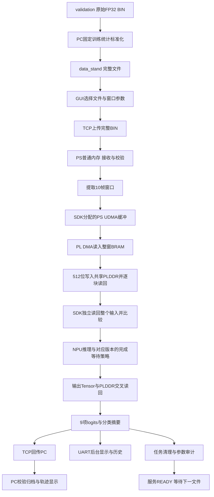
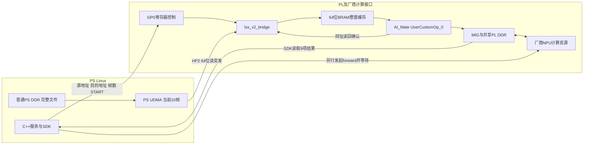
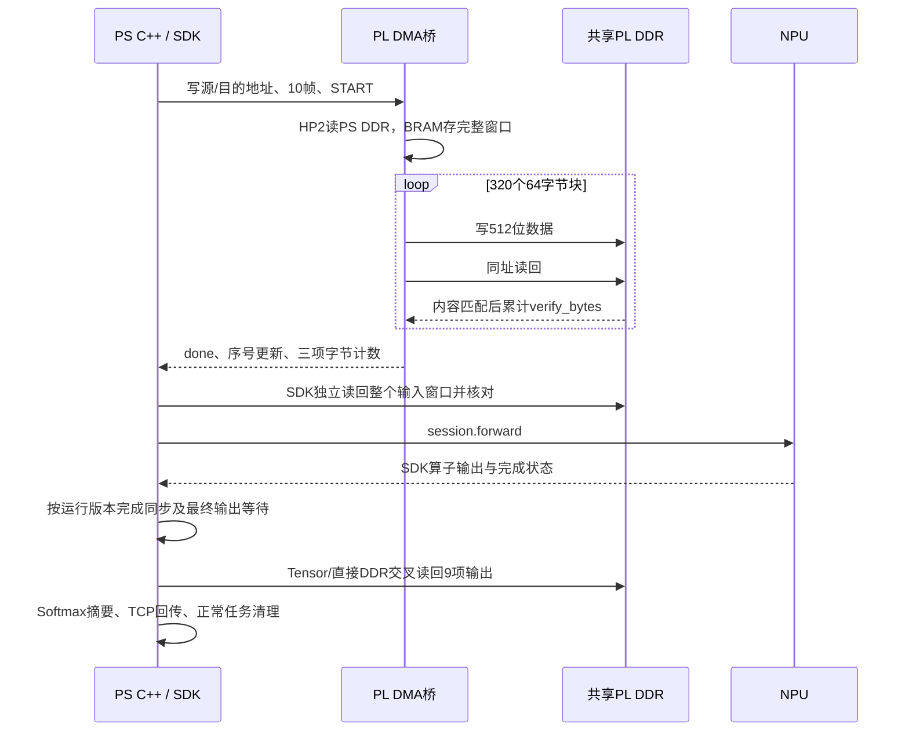

# 项目实现

更新日期：2026-11-02。本文为项目综合说明，汇总Windows scriptsv2上位机、TCP协议、ARM64 PS C++、PL DMA桥、ZG330 NPU，以及独立的PS优化/计时/UART串口屏工程。日常启动与当前板端目录以[操作步骤_V2.md](操作步骤_V2.md)为准；UART硬件、屏幕工程和协议细节见[UART实现和链路优化.md](UART实现和链路优化.md)，SSH设置见[SSH密钥代理与免密传输操作步骤.md](SSH密钥代理与免密传输操作步骤.md)。

版本边界：根目录src及原build/lss_v3保留r04基线；当前独立PS优化源码为upgrade_v/lss_hsrv3_timing，板端约定目录为/root/lss_hsrv3/lss_hsr_v4/lss_hsrv3_timing，程序为build_ps/lss_v3_timing。timing/lss_hsrv3_timing和UART文档前半部分记录较早集成版本，不与当前F+PS优化版混用。本次通过本地源码、交付包和已有说明核对，不表示远程检查了板卡当前进程或新增实板验收。

本文第3～4节保留共用数据通路及r04基线的技术细节；涉及同步、复位、计时和启动参数时，以第3.8节及第14～15节的版本区分为准。当前F版不是简单在原r04命令里关闭同步开关。

## 1. 系统分工

| 部分 | 当前职责 | 主要入口 |
|---|---|---|
| Windows PC数据准备 | 使用训练统计标准化完整BIN，保留帧顺序和类别目录 | tools/standardize_full_files.py |
| GUI | 连接、选窗、顺序收发、任务表、九类图片及局部轨迹 | scriptsv2/gui.py |
| 后台任务控制 | 单一socket所有者、串行任务、STOP与状态事件 | scriptsv2/controller.py |
| TCP客户端 | 帧编码、上传、收包、CRC及分类摘要校验 | scriptsv2/client.py |
| 结果查看与标签 | 归档验证、频谱/轨迹关联、发送类别及图片显示 | scriptsv2/results.py、input_data.py、class_labels.py、detail_charts.py |
| PS C++服务 | 文件接收、参数检查、选窗、推理调度、清理与回传 | src/main.cpp、src/service.hpp |
| 硬件后端 | SDK模型加载、内存绑定、DMA、NPU调用与读回 | src/hardware.hpp |
| PL控制桥 | 将PS DMA缓冲中的W10写至模型输入PLDDR并确认写入完成 | src/v2_bridge.hpp |
| 参数布局与审计 | 连续打包HardOp参数，核对权重/指令读回 | src/model_params.hpp |
| r04运行诊断 | 基线的算子回调、逐算子等待与跟踪 | src/runtime_trace.hpp |
| 当前PS优化与阶段计时 | CRC复用、数值校验热路径、独立计时与F运行策略 | upgrade_v/lss_hsrv3_timing/src |
| UART显示与历史 | 独立串口设备、HMI后台线程、分页及持久化 | 同上hmi_uart.cpp、hmi_history.cpp、hmi_bus.hpp |
| 硬件输出保护 | 检查预填值、非有限值及Tensor/DDR读回一致性 | src/output_guard.hpp |

板端不运行Python。Windows exe不能直接放到ARM64板卡运行；部署的是C++源码、配置与模型，在板卡用Icraft3.36.1原生编译。当前沿用已有V2 BOOT/PL，不因PS程序更新而重新综合或刷BOOT。

## 2. 数据流



PC对纯频谱文件完整发送，而不是只发一个窗口；对new_data组合BIN先按帧拆出完整频谱发送，轨迹留在PC。板端先用普通PS内存保存本任务上传正文；校验通过后逐窗口复制到SDK分配的PS UDMA缓冲。PL DMA将这一窗口写入SDK绑定的模型输入PLDDR，读回与源窗口逐字节比较。普通PS接收内存、PS UDMA和模型输入PLDDR是不同的存储位置。

输出成功回传后，板端清理本任务输入/输出及UDMA缓冲，并核对清理读回；常驻模型权重、指令及SDK管理的其他区域不做整片清零。完成清理再返回服务READY。硬件FAULT时不按成功路径清理复用，不发送成功DONE或READY。

## 3. PS实现：接收、内存管理与推理调度

### 3.1 运行环境与服务入口

PS运行ARM64 Linux，当前用户日志为Ubuntu20.04.4、Linux5.4.52 aarch64。服务是C++17可执行程序build/lss_v3，使用Linux socket、线程和Icraft3.36.1 SDK；端口绑定、接收、参数检查和结果解释在PS执行。GUI TCP数据通道不依赖SSH认证；串口和SSH属于登录/部署通道，不能与TCP业务协议混淆。

src/main.cpp提供三种入口：--binding-check仅做Mock绑定，--file从板上文件选窗，--serve常驻监听TCP。真实硬件后端只允许AArch64 Linux，不会因NPU不可用自动退回CPU。启动时读取配置，核对输入/输出类型与形状，取得进程间锁/run/lock/lss_hsrv2.lock，避免V2/V3同时操作同一硬件。

### 3.2 完整文件接收与PS DDR

src/net.hpp先接收4字节大端JSON头长度，再接收JSON头和声明长度的正文。TCP可以分段或合并，程序循环读取直到正文完整，不把一次recv当作一个文件。src/service.hpp在START阶段检查文件字节数、帧数、格式、CRC字段及选窗范围，批准后接收DATA。

正文存入Bytes（std::vector<unsigned char>）普通用户态内存，通常由Linux映射到PS DDR。完整接收后核对实际长度、CRC32和全部FP32有限性，成功才发RECEIVED并执行推理。默认单文件上限64MiB、单任务最多4096窗，属于软件限制，不代表实际可承受的并发或吞吐。

此处“先保存BIN到PS DDR”指内存暂存，TCP服务没有自动将上传正文永久写成板端磁盘文件。普通vector的虚拟地址不能直接交给PL DMA，也不承诺物理连续。当前服务按任务接收和处理，不实现未知长度输入流、跨文件环形缓冲或网络与NPU双缓冲流水线。

### 3.3 选窗与DMA缓冲

PS根据窗口起点s+i*d计算字节偏移：offset=(s+i*d)×2048，复制20480字节到当前窗口容器。以38帧文件起始帧2、窗口数1为例：完整文件77824字节先进入PS普通内存，再取偏移4096起的20480字节。

src/hardware.hpp通过dev.getMemRegion("udma").malloc(20480,true,64)向SDK申请64字节对齐的PS DMA缓冲。其物理地址由SDK返回，再把窗口从普通内存复制到该缓冲；不独立mmap并覆盖整个udmabuf区域。已见日志中的源地址为0x31100000，但不能将其作为所有版本和运行的固定地址。

### 3.4 模型常驻、SDK分配与绑定

服务创建时加载JSON与RAW，建立Network/NetworkView和ZG330Backend Session。自定义代码禁用OCM优化、ETM优化和HardOp合并，检查所有前向绑定均为ZG330硬件后端。模型权重/指令常驻，连续任务复用同一个模型实例，不为每个文件重新加载整个RAW。

SDK的forward_info提供模型输入、输出的物理地址和所属MemChunk。程序同时核对存储字节数、内存区域、块内offset、64字节对齐、32位桥接地址可达性以及输入/输出不重叠；还检查输入/输出区域不覆盖常驻权重和指令。

输入、输出地址由Runtime实际分配，不硬编码成诊断模型地址。ResNet实板日志曾为输入0x0199a000、输出0x0199f000；诊断模型曾为0x0000d000/0x00012000。这些是模型PLDDR地址空间中的地址，不能直接当作PS虚拟指针或Linux进程可直接访问的物理地址。

### 3.5 PS到PL的命令顺序

src/v2_bridge.hpp执行以下过程：

1. 核对LSV2、桥ABI版本和LSC2签名，要求DDR就绪且桥空闲。
2. 记录本次开始前的完成序号和拒绝计数。
3. 向桥寄存器写入SDK返回的PS DMA源地址、Runtime模型输入目的地址和固定10帧。
4. 写START=1，轮询完成状态及新序号，超时上限15秒。
5. 要求无BUSY、无ERROR、错误码为0，PS读取/DDR写入/DDR读回三项计数均为20480，拒绝计数未增加。
6. 再通过SDK读回模型输入，与源窗口逐字节比较，才允许session.forward。

PS这次输入准备没有用CPU直接把标准化窗口正文写到模型输入PLDDR来替代PL搬运。程序会先向输入/输出写0xff检测填充值，但有效输入必须来自随后通过检查的PL DMA结果。

### 3.6 NPU调度、输出和回传

PL桥完成只表示输入就位。PS随后调用session.forward，并使用SDK实际返回的Tensor执行等待；原r04基线还在每个算子的post callback等待其输出就绪，再推进后续算子。当前F版的等待和复位策略见第3.8节。最终核对输出Tensor地址仍是绑定缓冲。

PS依次执行直接DDR读回、Tensor读取、再次直接DDR读回，按完整字节比较；全0xff、NaN/Inf或三次结果不一致进入HardwareFault。成功后在PS计算Softmax与类别摘要，通过TCP发送36字节原始logits及带CRC/shape/start_frame的RESULT头。SDK层计数与64个软件HardOp的含义不同，不能直接要求两者数值相等。

### 3.7 任务线程、正常清理与故障

接收线程处理控制头和连接状态，推理任务线程串行执行选定窗口；互斥状态保护下一任务的准入，避免尚在清理时提前接受START。GUI后台也只有一个socket所有者。

正常任务逐窗回传，全部完成后发DONE，擦除本任务PS临时容器，再清理UDMA和模型输入/输出区域并核对清零读回，记录CLEANED，最后发送服务READY。常驻权重/指令不随每个任务清零。

推理、清理或硬件监控进入FAULT时，不走正常硬件缓冲清理/复用路径。程序保留可能仍被硬件使用的资源，报告requires_restart=true；PS普通临时容器与硬件DMA资源的生命周期需要区分。该状态不是删除日志或跳过检查即可恢复。

### 3.8 模型加载调用链与F版本区别

启动参数--config选择程序配置，而不是直接选择一个RAW。Config解析json/raw字段，按配置文件父目录解析路径。Hardware构造函数依次执行：

```cpp
net = icraft::xir::Network::CreateFromJsonFile(cfg.json.string());
net.loadParamsFromFile(cfg.weights.string());
// 检查输入输出，准备NetworkView及连续参数布局，打开ZG330设备。
session = icraft::xrt::Session::Create<icraft::xrt::zg330::ZG330Backend>(view, {dev});
session.apply();
// 输入搬运及校验完成后：
auto returned = session.forward({input->tensor});
```

这是调用顺序摘录，不是完整独立可编译函数。原代码在src/hardware.hpp；当前代码在upgrade_v/lss_hsrv3_timing/src/hardware.hpp，其中forward被PerfSummary包裹计时。RuntimeTrace用于跟踪，不负责替代Session执行模型。模型在启动时加载一次，权重/指令常驻，不随每个BIN重新从磁盘加载。

原r04基线依赖逐算子应用回调等待。独立F版在每次forward前执行dev.reset(1)，trace关闭时不注册应用层逐算子回调，依靠SDK调度及最终返回Tensor.waitForReady；trace调试数据按需构造。仍检查输入、最终输出地址、A/B/C一致性、非有限输出和清理结果。F版行为来自其配套实现，不能据此直接对原r04关闭同步或删检查。

model/config分别保存网络结构与参数、程序选择及语义。旧模型配置resnet34_r01.json指向ResNet34_radar_ZG.json/raw；v2配置resnet34_r02.json指向ResNet34_radar_ZGv2.json/raw。v2为模型版本，与r04运行时、UART版本及操作说明V2不是同一版本编号。

本地v2检查结果：Icraft v3.36.1、目标zhuget(330)、FP32输入[1,10,512,1]和输出[1,9]与原模型兼容，RAW长度22,687,106字节、MD5为63fc28548aa4d57443c1b77819c01719且与模型JSON记录一致。只证明该次文件配对及接口兼容，后续更新应重新核验文件身份、训练预处理和类别顺序。

## 4. PL实现：读DMA、BRAM组窗与共享DDR写入

### 4.1 顶层与模块连接

Vivado工程入口prj/hardware/lss_hsrv3.xpr，顶层ai7030_edif_top。顶层例化ps_ai_peripheral，后者连接PS块设计ps_ai_wrapper、GP控制接口、HP接口、lss_v2_bridge、lss_system_ctrl、厂商AI_Mate和单个MIG DDR3控制器。

| 模块/文件 | 实际职责 |
|---|---|
| prj/hardware/rtl/ai7030_edif_top.v | 板级PS固定IO、PS DDR、PL DDR、时钟、LED/JTAG顶层 |
| prj/hardware/rtl/ps_ai_peripheral.sv | PS/AI_Mate/MIG与自定义桥的互连和复位连接 |
| prj/hardware/fpai_demo_vivado.srcs/sources_1/bd/ps_ai/ps_ai.bd | PS块设计及其AXI互连配置 |
| prj/rtl/lss_v2_bridge.sv | 从PS DDR读数据、整窗BRAM暂存、512位DDR写入及读回屏障 |
| prj/rtl/lss_system_ctrl.sv | 独立非视频系统控制、软复位状态和LSC2签名 |
| prj/rtl/v2_cdc.xdc | GP/HP跨时钟域约束 |
| prj/hardware/rtl/edif/AI_Mate.edif | 厂商AI_Mate网表及其接口实现 |
| mig_7series_0 IP | 实际PL DDR3初始化、校准与存储访问 |

自定义桥不包含ResNet卷积、残差、池化或全连接数学实现；模型计算由编译指令、厂商NPU资源和Icraft Runtime共同完成。工程保留部分旧SDI/视频资源文件，不代表本次信号识别数据经过视频链路。当前顶层和服务使用保留的非视频控制身份LSC2。

### 4.2 控制通路与数据通路



控制通路为PS GP0地址译码后的User寄存器窗口；搬运数据通路为PL桥作为AXI读主机，经PS的S_AXI_HP2读取PS DDR。ps_ai_peripheral中该HP2通道的写地址/写数据有效信号固定为0，只使用其读取方向。

桥通过AI_Mate的UserCustomOp_0接口访问与NPU共享的PL DDR，并非自定义桥另建一套独立模型DDR。MIG的init_calib_complete和ui_clk_sync_rst组合成ddr_ready条件，DDR未就绪时不允许有效搬运。

### 4.3 读DMA与整窗BRAM

lss_v2_bridge.sv的PS读数据宽64位，ARLEN=7、ARSIZE=3，即每突发8拍、每拍8字节，共64字节；使用INCR突发。源地址64字节对齐，每次增加64字节，不跨4KiB边界。读数据必须按预期拍数出现RLAST，且RRESP为成功响应，否则记录错误并终止本次搬运。

BRAM声明为memory[0:5119]、每项64位，总容量40960字节，可容纳RTL支持的最多20帧。当前C++固定只使用10帧，即20480字节、2560个64位字。先完整读入窗口，再开始向目的DDR写出，不是网络流直接逐字送入NPU。

RAM用同步读流程PACK_REQ→PACK_WAIT→PACK，取连续8个64位字按lane顺序拼成一个512位块，保留源字节与帧/频点顺序，不做标准化、浮点转整数、缩放或类别判断。对10帧窗口共有320个64字节块。RAM数组本身不逐任务复位，控制状态只允许读取本任务已写入的数据。

RTL帧数校验允许1～20，是DMA桥能力；当前模型适配层只允许10帧。不能仅修改GUI的窗口宽度就让ResNet接受20帧输入。

### 4.4 512位写入与读回屏障

UserCustomOp_0写通道使用512位数据、64字节全字节使能。该接口没有供自定义桥使用的AXI B写响应，单凭awready不能证明写数据已经对后续读取可见。

因此每个64字节块写入握手后，桥都会向同一地址发起读回，比较返回的512位内容与packed_data。若读到旧数据，会在最多1024次读回比较范围内轮询；读回标志错误或达到重试边界仍不一致，报错误7。某次读请求若始终没有返回，RTL不会自行计时结束，外层由PS的15秒搬运超时监控处理，不能把1024次比较误读为完整总线超时保护。

只有全部块完成写入和读回匹配，verify_bytes才累加到20480并发完成确认。PS还进行独立整窗读回比较。这两层检查分别覆盖PL端写可见性和PS观察到的模型输入内容。

### 4.5 搬运状态机

```text
IDLE → CHECK
     → PS_ADDR → PS_DATA（重复读取完整窗口）
     → PACK_REQ → PACK_WAIT → PACK
     → DDR_WRITE → DDR_ADDR → DDR_DATA
       ├─ 读到旧内容：有限次数重新读回
       ├─ 当前块匹配：继续下一块PACK_REQ
       └─ 全部完成：FINISH → IDLE
任一参数/总线/校验失败：FAILED → IDLE，并回报错误码
```

一次完成或失败都会通过ack翻转通知GP侧，并递增完成序号。完成状态中的DONE表示“这次桥命令已结束”，仍必须检查ERROR和错误码；DONE本身不是成功证明，更不代表NPU推理结束。

### 4.6 GP/HP跨时钟与复位

GP域处理配置寄存器和软件轮询，HP域执行读DMA、BRAM和User DDR访问。command翻转经cmd_h1/cmd_h2两级同步送往HP；结果ack经ack_g1/ack_g2返回GP；DDR就绪信号也同步到GP。

源地址、目的地址和帧数在busy期间保持稳定，HP在同步后的命令到达后采样；结果计数和错误码先保持稳定，再通过同步后的ack通知GP读取。这是握手配合保持数据的跨域方式，不是对每个多位配置总线逐位加同步器。busy期间新的写入会增加rejected计数，不覆盖正在执行的参数。

prj/rtl/v2_cdc.xdc对相关GP→HP、HP→GP路径分别设置5ns和10ns的datapath约束，并处理同步器首级和异步hold关系。它们是实现约束，不是本文新增的实测性能指标；当前不据此宣称新的时序签核。

lss_system_ctrl保留软复位控制和完成标志：写0x70触发soft_reset，计数到100后自动释放并置reset_finished；0x7c返回LSC2签名。独立global_reset_n避免控制模块被自身soft_reset永久锁住。自定义桥初始化读取签名，不在每次推理后写此系统控制软复位寄存器。当前F版forward前调用SDK dev.reset(1)，与这里的系统控制寄存器复位不是同一操作。

### 4.7 PS/PL寄存器与地址空间

以下是源码中当前接口，便于解释日志，不是手工写寄存器的操作步骤。日常由SDK和Bridge执行，不通过devmem改写状态。

| 名称 | 当前地址/形式 | 用途 |
|---|---|---|
| SDK NPU寄存器区域 | npu=0x40000000 | SDK设备控制地址基准 |
| SDK DMA设备区域 | dma=0x80000000 | SDK设备访问参数；不是上传BIN或UDMA的存储地址 |
| 自定义桥寄存器窗口 | NPU区域内偏移0x000c0000，即0x400c0000起 | LSV2命令、状态、地址和计数 |
| 独立系统控制窗口 | 0x40080000起 | soft_reset、完成标志和LSC2身份 |
| PS UDMA源地址 | SDK动态返回，日志曾为0x31100000 | PL可读取的当前窗口物理缓冲 |
| 模型输入/输出PLDDR地址 | SDK按模型动态分配 | 与PS内存地址属于不同访问空间 |

桥窗口内偏移定义如下：

| 偏移 | 读写 | 含义 |
|---|---|---|
| 0x00 | 读 | 签名0x4c535632，即LSV2 |
| 0x04 | 写 | 写1启动一次搬运 |
| 0x08 | 读 | bit0 busy、bit1 done、bit2 error、bit3 DDR ready |
| 0x0c | 读 | 完成序号，每次命令结束递增 |
| 0x10 | 读写 | PS物理源地址 |
| 0x14 | 读写 | 模型输入PLDDR目的地址 |
| 0x18 | 读写 | 本次帧数，当前C++写10 |
| 0x1c | 读 | 从PS读取的字节数 |
| 0x20 | 读 | 已被写接口接受的字节数 |
| 0x24 | 读 | DDR读回匹配的字节数 |
| 0x28 | 读 | 错误码，0为无错误 |
| 0x2c | 读 | 被拒绝的寄存器写/命令计数 |
| 0x30 | 读 | ABI版本0x00010000 |

RTL错误码：1=帧数越界；2=源地址不对齐或超出PS低1GiB范围；3=目的地址不对齐或超出32位范围；4=DDR未就绪；5=PS读响应错误；6=RLAST/突发拍数异常；7=目的DDR读回标志或内容校验失败。同一拍同时异常时以RTL非阻塞赋值的最终结果为准，不把错误码表当成覆盖所有同时故障的独立诊断器。

### 4.8 PS/PL协同完成条件



桥完成、NPU完成和服务READY是三种不同事件：桥完成只保证输入搬运；NPU完成由SDK等待及有效输出检查确认；READY还要求本任务结束及清理完成。当前实现串行复用这些资源，不宣称DMA和NPU并行处理两个窗口。


## 5. 输入与预处理

原始数据为FP32小端，每帧512点，每帧2048字节。当前validation含250个BIN，9个对象目录：Bird、Birds、Car、Rotate、UAV1、UAV2、UAV3、UAV4、Wing Bird。

完整标准化数据位于dataset/data_stand，仍为250个文件、9489帧、19433472字节，单文件10～70帧。类别目录及文件名保留；文件名后缀不能替代实际字节长度检查。

训练统计由964个训练MAT计算，开发集和最终留出集不参与：

```text
mean = 137.53303464225368
std  = 10.262633165907761
z = (x - mean) / std
```

这是固定全局标准化，不是每个测试文件或窗口独立归一化。输出仍为FP32小端，不裁剪少量量化范围外尾部，不修改模型入口scale。config/training_standardization.json记录确认参数和来源；处理清单记录源/输出SHA256、帧数和公式验证。

旧output/training_standardized_20261021中的250个文件仅保存首10帧，适合单窗验证；新data_stand完整保留帧数，支持GUI选择后续起始帧。当前GUI和板端都不会再次标准化，用户必须选择正确的已处理文件。

## 6. 选窗语义

以下为底层协议及板端文件模式的通用选窗能力；新版scriptsv2 GUI固定窗口数1、步长1，仅开放起始帧。固定模型窗口W=10；文件N帧，起始帧s、步长d。完整窗口数量为：

```text
available = floor((N - s - 10) / d) + 1   （N >= s + 10，d >= 1）
```

窗口数0表示使用全部available个完整窗口，正数表示明确请求相应数量且不能超过available。第i个窗口从s+i*d开始，每次读取10帧。

例：38帧文件、s=2、窗口数1，读取第2～11帧；若窗口数0、d=10，起点为2、12、22，共3窗。一个恰好10帧的文件只有s=0合法。

A/B/A是三个文件任务，各自完整上传并使用同组选窗参数；不是TCP底层的三个网络分包，也不是一个BIN的三个连续窗口。当前协议预先声明每个文件长度和选窗数量，尚不是未知长度的实时流输入。

## 7. 模型与输出

config/resnet34_r01.json引用model/ResNet34_radar_ZG.json和.raw。模型输入[1,10,512,1]、20480字节，输出[1,9]、36字节，kind=classification、output_semantics=logits、preprocessing=none。编译模型包含64个HardOp；参数布局修复打包37个权重组。

9个输出是logits，可包含负数，不能直接当成概率。程序使用稳定Softmax：先减最大logit、指数化、归一化，取最大值的下标作为class_id，取其概率作为score。串口摘要例：RESULT class=8 score=0.7984。TCP结果正文仍是原始9项FP32。

当前labels是字符串0～8，真实训练编号映射未提供。PC250份首窗预测的多数对应为0/UAV1、1/UAV2、2/UAV3、3/UAV4、4/Bird、5/Birds、6/Wing Bird、7/Rotate、8/Car；这只是统计推测，未写为正式标签，也未据此计算准确率。

诊断模型ddr_reader_ZG实现近似y=0.5x+1，输入输出都是10×512 FP32，只有6个HardOp，用于验证搬运及推理链路；诊断模型通过不能替代ResNet实板验收。

## 8. 通信与状态

GUI连接TCP5001；SCP/SSH22只用于部署和日志下载，串口负责人工配置网络、编译和启动。服务监听0.0.0.0表示本机所有网卡，不是GUI应填写的目标地址。

协议使用长度标识的JSON头和声明长度的二进制正文，包含version、type、task_id、payload_bytes等字段。客户端和服务端校验长度、CRC32、帧完整性、选窗边界及FP32有限性；不依赖TCP报文边界。

正常顺序：服务READY → START → 上传READY → DATA完整文件 → RECEIVED → 一个或多个RESULT → DONE → 本地CLEANED日志 → 服务READY。CLEANED由服务本地记录，客户端以任务完成及后续服务READY确认可继续。

DONE中的ready=false表示还未允许下一任务；等待服务READY后才发下一个。GUI后台控制器是socket唯一所有者，连续文件按顺序执行，不让多个线程同时读取协议流。STOP采用finish_task，完成当前任务选定窗口后停止，不继续列表剩余文件。

可恢复的参数/上传任务错误在确认CLEANED和READY后可继续；硬件停滞、预填输出未覆盖、非有限硬件输出或不稳定读回进入FAULT，requires_restart=true，保存现场并停止新任务，不自动重发。

## 9. 已处理的问题与证据

### 权重预检误报

SDK组级预检从首参数地址比较整组字节，而原参数Host缓冲不连续，可产生“Weight of opid…incorrect”。V3将同一HardOp参数放入共享连续Host存储，保留原字节、类型和逻辑地址；继续保留SDK预检和独立设备参数读回审计。未修改模型权重数值，也没有跳过预检。

### 未标准化导致固定输出

旧原始BIN直接输入时，PC真实模型对照返回固定class0、score约0.3333，输出SHA与历史板端一致。改用训练固定统计后，250份首窗输出均有限且各不相同，重复一致。标准化解决输入分布问题，不等于解决所有硬件时序问题。

### 第二次ResNet输出全0xffffffff

程序推理前用0xff填充输出。旧版第二次读到全部预填值，同一输入、同一进程、无GUI两窗也复现；诊断模型正常。r04加入逐算子SDK Tensor等待、完整调度/层计数日志、Tensor与直接DDR三次读回比较，并将未覆盖/非有限硬件输出改为FAULT。

用户提供r04实板日志：ResNet两次64算子序列一致，层计数0→60→120，两次输出CRC=4e02fe98，Tensor/DDR一致，DONE/CLEANED/READY且退出/比较均0。随后GUI日志推进至sequence18，末次层计数1080、有效输出CRC=e8e82f8b、class7、score约0.9999，完成并恢复READY。用户反馈测试正常。

这些结果支持修复方案在所提供场景有效；由于同步与诊断同时变化，精确因果没有完全分离，不宣称覆盖所有输入和长时间压力场景。源码包生成记录中的board_tested=false描述自动打包/本地检查没有代替实板执行，不应与用户提供的特定实板证据混为一谈。

## 10. 上位机实现及与板端的对应关系

本节更新于2026-11-02，以当前scriptsv2“LSS_HSR目标识别”及共用TCP协议为准，板端实现同时区分r04基线与独立UART/PS优化版。按端口连接、任务协议、输出读取、界面功能的顺序说明。原pc目录保留旧版上位机，不应用旧版界面说明替代新版行为。

### 10.1 TCP5001连接哪一部分，代码如何体现

GUI连接的是PS Linux中运行的lss_v3进程创建的TCP监听socket。网口提供网络通路，板卡IP定位设备，5001定位该设备上的服务端口；5001不是NPU硬件地址或独立NPU端口。Linux内核将该连接的数据交给应用程序的socket，应用再解析协议并调用SDK。

| 代码位置 | 对应作用 |
|---|---|
| scriptsv2/controller.py，Controller._run连接分支 | socket.create_connection((host, port), timeout)，GUI发起连接 |
| scripts/run_resnet_r04.sh | 使用--serve、--backend hardware、--port 5001、--feedback tcp启动服务 |
| src/main.cpp，main的--serve分支 | 读取端口参数，默认5001，调用service.serve(bind, port, once) |
| src/service.hpp，Service::serve | 创建socket、配置addr.sin_port=htons(port)、bind、listen、accept |
| src/service.hpp，Service::connection及Service::run | 接收控制头和正文、校验、调用backend.infer(window)、发送结果 |
| src/hardware.hpp，Hardware::infer | 通过session.forward({input->tensor})发起硬件推理并等待输出 |

```text
GUI → PC socket → 网络 → 板卡网口/Linux TCP栈
    → lss_v3监听的5001 socket → Service::connection/run
    → Hardware::infer → Icraft SDK → NPU
```

三种入口中只有--serve监听TCP端口。--file从板卡本地文件直接执行选窗和推理，不通过5001；--binding-check检查绑定，不进行真实硬件推理。serve本身负责服务和任务调度，具体NPU工作由其调用的硬件后端完成；不能仅凭TCP连接成功认定NPU已经执行。当前硬件启动脚本明确指定hardware，GUI保留模型元数据和physical_execution信息用于判断任务状态；主界面已移除原模型信息文字行。

### 10.2 任务头有哪些字段，由谁生成

GUI提供文件选择、起始帧、连接及结果目录等输入；scriptsv2/client.py的submit读取完整BIN，根据实际字节生成任务头。当前gui.py的parameters固定返回(start, 1, 1)，高级窗口设置及其按钮已移除。

| START字段 | 含义/当前来源 |
|---|---|
| version | 协议版本，当前1 |
| type | 消息类型，任务申请为START |
| task_id | 自动生成的task_加32位UUID十六进制字符串 |
| payload_bytes | START正文为0；不是BIN长度 |
| file_bytes | 实际上传的整个BIN字节数 |
| frame_count | file_bytes/2048，必须为完整帧 |
| dtype | float32_le，数据为小端FP32 |
| bins_per_frame | 512 |
| window_size | 10帧 |
| start_frame | GUI起始帧，从0开始 |
| windows | 当前新版GUI固定1 |
| stride | 当前新版GUI固定1；单窗口时不产生后续滑动窗口 |
| crc32 | 根据整个待上传BIN计算的8位十六进制CRC32 |

PC结果目录、原文件路径不随START发送。source_path仅附加在PC本地保存的task.json中，板端不依赖PC盘符或目录。

### 10.3 线上排布顺序、实际发送大小与接收推进

scriptsv2/client.py的encode将每条协议消息编码为：

```text
字节偏移0～3：4字节无符号大端整数H，表示JSON头的字节数
字节偏移4～4+H-1：H字节JSON头（UTF-8；客户端将非ASCII字符转义）
随后：payload_bytes字节二进制正文，没有额外分隔符或结束符
```

4字节前缀只计算JSON头长度，不包含前缀本身和正文。每个JSON头限制为1～65536字节。二进制BIN中的每个FP32数仍为小端，不能将其与头长度的大端编码混淆。

当前客户端生成START时JSON字段按10.2表从上到下的顺序写出；这是当前编码器的插入顺序，不是固定长度结构体布局。板端按字段名解析，字段重排不影响含义；数字字符位数变化会改变头长，因此没有固定字节偏移供手工读取file_bytes等字段。重复键会被拒绝。

以下是一个恰好10帧、20480字节全零BIN的实际编码示例，task_id采用与真实UUID任务ID相同的37字符长度，仅为说明：

```json
{"version":1,"type":"START","task_id":"task_aaaaaaaaaaaaaaaaaaaaaaaaaaaaaaaa","payload_bytes":0,"file_bytes":20480,"frame_count":10,"dtype":"float32_le","bins_per_frame":512,"window_size":10,"start_frame":0,"windows":1,"stride":1,"crc32":"e6bc8360"}
```

START的JSON头为249字节，前缀为00 00 00 f9，总计253字节，无二进制正文。板端检查通过并返回上传READY后，PC发送另一条DATA消息：

```json
{"version":1,"type":"DATA","task_id":"task_aaaaaaaaaaaaaaaaaaaaaaaaaaaaaaaa","payload_bytes":20480}
```

DATA头为99字节，前缀为00 00 00 63，随后紧接20480字节BIN，总计20583字节。此示例两条PC请求合计20836字节，不包含板端响应、TCP/IP/链路层开销。其他文件的头长应按实际JSON计算，不能把249/99当作协议常量。

TCP是字节流，不保证一次send对应一次recv，也不保证以上一条消息装进一个网络报文。服务端src/net.hpp的header先精确读取4字节长度，再读取JSON头；src/service.hpp先通过plan检查START，批准后验证DATA的task_id与正文长度，接收声明的完整正文到PS普通内存，再校验长度、CRC及FP32有限性，之后才提取窗口推进推理。

当前默认单任务BIN上限64MiB=67108864字节=32768帧；大小必须为2048字节整数倍且覆盖所选10帧。--max-file-bytes可在启动时调整，代码允许最高256MiB，实际可用还受板卡内存和传输超时限制。GUI根据服务READY中的max_file_bytes预先拒绝超限文件，板端也独立校验。当前不会自动截断：完整文件仍先上传，新版GUI只推理其中一个10帧窗口。只保存前X字节属于后续改造，尚未实现。

### 10.4 PS直接读PL_DDR与Tensor读取的区别

两种方法均由PS程序通过SDK读取同一个NPU输出PL_DDR区域；直接读取并不表示PS绕开SDK或直接解引用一个物理地址。

| 路径 | 当前调用 | 主要依据 |
|---|---|---|
| 直接区域读取 | region.read(..., MemPtr(output->address), out_bytes) | 显式指定设备内存区域、输出地址和字节数 |
| Tensor对象读取 | returned[0].read(..., 0, out_bytes) | 使用session.forward返回Tensor的内存绑定和相对偏移 |

返回的Tensor还携带SDK运行时完成检查能力。程序显式调用waitForReady，并检查Tensor属于预期内存区域且地址等于绑定输出地址，之后才执行交叉读回。直接region.read调用本身不能作为“NPU已经完成”的证明。两种读路径是否有独立缓存等内部机制不能仅凭这些调用断言；本程序通过实际字节比较检验可见结果。

```text
NPU → 写入模型输出PL_DDR【实际硬件输出位置】
             ├─ region.read → direct_before（PS缓冲A）
             ├─ Tensor.read → p.data（PS缓冲B）
             └─ region.read → direct_after（PS缓冲C）
```

A/B/C是说明用名称，均为同一次推理结果的PS内存副本，并非三个NPU输出目的地址，也不是三次推理。ResNet输出9个FP32，各副本36字节。src/output_guard.hpp检查三者完整字节一致、不是全0xff预填值并且浮点数有限；日志CRC是辅助追踪信息，实际比较不只比较CRC。读取不会清空PL_DDR或将模型输出层变为NULL。p.data通过检查后用于生成分类摘要和回传原始输出；后续任务清理另行执行。

### 10.5 当前GUI界面、标签与轨迹

主界面顶部为板卡IP/端口/超时及连接按钮，原“模型：resnet34_r02…”信息行已移除，连接与读取模型的协议仍保留。左侧为待发送文件、起始帧、PC结果目录、发送及停止服务；没有窗口数/步长高级设置。每文件固定从起始帧取连续10帧，parameters返回(start,1,1)。

结果表从左至右为“数据编号、输入文件、发送类别、任务状态”，不再显示预测类别或最高概率。编号从R0001递增，新记录插入顶部，显示顺序从大到小；清空后重新编号。编号属于PC界面会话，与TCP task_id或UART持久历史编号不是同一个标识。加载历史或示例也按添加先后编号，不按原文件名排序。

结果区有查看识别详情、加载历史任务、加载离线示例、打开结果目录及清空任务结果。清空只删除界面记录和当前详情窗口，保留PC文件、通信日志、待发送列表、连接及模型元数据；忙碌/停止中禁用。可以重新加载历史记录。

支持两种输入：512点/帧纯频谱BIN；dataset/new_data中517点/帧组合BIN及同名JSON。组合每帧为512个标准化频谱值和5个未标准化航迹值，FP32小端共2068字节；GUI核验元数据和SHA256后分离，线上只上传完整512点/帧频谱。发送类别取同名JSON的category并保存在任务ground_truth，纯频谱或旧任务没有可信标签则显示未知；不依据预测或目录名猜测，也不把标签通过START/DATA发给板卡。

详情顶端从左至右显示UAV1、UAV2、UAV3、UAV4、Bird、Birds、Wing Bird、Rotate、Car的九张参考图片，图片下方有类别名称。红框标记归档的发送类别，不是预测类别；标签缺失/无效时不加红框。图像从assets/class_images/class_images.json及class_0.png～class_8.png加载，缺失显示占位。这些是类别示意图，不是本次目标实拍图。

下方仅显示局部运动轨迹及坐标轴/网格/帧号和起终点，原上下说明、左侧图片卡片/图例、概率摘要和刻度/窗口设置不再显示。当前单窗口任务正常显示10帧；旧多窗口历史默认显示第一个归档结果窗口。预测与概率仍保存在输出和任务证据中，移除显示不改变模型计算。

轨迹按range_km与azimuth_deg投影X=1000×range×sin(azimuth)、Y=1000×range×cos(azimuth)，再减去窗口首点坐标；单位m，X/Y等比例自动适应选段，不等同于已标定地理坐标或斜距校正后的地面坐标。频谱与轨迹同取s～s+9帧，输入快照20480字节、轨迹快照200字节，以任务、帧起点、源SHA256和CRC绑定。旧任务无轨迹或校验失败时明确提示，不伪造轨迹。

加载离线示例提供9份实际HostBackend输出及9份人为指定类别的显示演示，均不是本次NPU执行。主表状态区分来源，原始归档保留该标识；详情精简不改变证据身份。最新Tk测试覆盖倒序编号、九张图片及名称、九种发送标签红框、未知标签、清空重载和缩放；不是实板精度验收。

## 11. 结果归档

PC每个task目录保存task.json（实际输入路径、长度、CRC和窗口参数）、model_info.json、events.jsonl（RESULT摘要）、windows.tsv、每窗口w10_sN.output.bin和client_report.json。输出BIN用于独立分析；GUI校验CRC并重算分类摘要。2026-10-24起，scriptsv2还保存实际发送切片w10_sN.input.bin及对应.input.json，包含窗口CRC、源文件CRC和形状。轨迹及输入关联校验优先使用本地归档快照，无需板卡回传输入；当前GUI不显示频谱，相关读取工具仍保留。旧任务无快照时，读取工具仅在原文件身份核对后回读。快照损坏不静默回退，原文件缺失不会影响已保存快照的新任务。

板端runtime_evidence每次独立目录保存console.log、退出码和文件模式结果。原r04的run_resnet_quiet.sh只过滤串口显示，run_resnet_r04.sh仍保留完整日志，过滤不改变其同步或审计参数。当前独立工程由run_hmi.sh输出TIMING_EVIDENCE并保存日志；其运行参数与原r04不同，见第12节。

通过CRC/摘要校验是传输/程序一致性证据，不等于分类真值正确。类别显示采用dataset.py记录的九类顺序，但仍需确认实际训练沿用该顺序并用可信留出集验证；不能把界面发送类别或CRC检查等同于当前移植版的完整准确率验收。

## 12. 构建、更新与迁移

### 12.1 当前交付路径

| 内容 | 路径 |
|---|---|
| 原r04基线 | 根src、原板端deploy_runtime_r04_01/lss_hsrv3_board_package |
| 早期timing/UART集成源码 | timing/lss_hsrv3_timing |
| 当前独立PS优化源码 | upgrade_v/lss_hsrv3_timing |
| 当前板端更新包 | upgrade_v/lss_hsrv3_uart_PS_upgrade_20261028.tar.gz及.sha256 |
| 当前板端约定工作目录 | /root/lss_hsrv3/lss_hsr_v4/lss_hsrv3_timing |
| 当前板端可执行程序 | build_ps/lss_v3_timing，另有lss_v3_baseline作对照 |
| 新版PC GUI | scriptsv2，双击启动上位机.cmd |
| GUI分发包 | output/LSS_HSR目标识别_GUI.zip |
| 组合频谱/轨迹数据 | dataset/new_data，BIN与同名JSON成对携带 |

当前原生编译以build_on_board.sh为入口，-j1；主程序/NPU封装保持-O0，独立ps_hotpath.cpp采用-O2、禁用fast-math和LTO。构建及源码/二进制哈希检查保留。构建完成提示board_inference_not_tested不能作为NPU验收。具体上传、swap及CTest命令见操作步骤_V2第8节；约1GiB板卡编译时启用已有/root/lss_v3_build.swap，勿重复格式化，编译结束后仅在内存允许时关闭Swap。

### 12.2 日常启动及模型选择

在板卡终端确认没有其他推理进程和串口演示程序占用后：

```bash
cd /root/lss_hsrv3/lss_hsr_v4/lss_hsrv3_timing
bash run_hmi.sh /dev/ttyACM0
```

当前脚本运行build_ps/lss_v3_timing，默认从原r04部署目录的config/resnet34_r02.json加载v2模型，监听0.0.0.0:5001，开启UART，audit-model=false、trace-runtime=false、sync-each-op=false；这是配套F实现的参数，不能原样套到未升级的r04基线。启动脚本只封装命令参数、完整性检查与日志，本质仍执行编译好的C++程序。

可用第二参数选择兼容的其他模型配置：

```bash
bash run_hmi.sh /dev/ttyACM0 /实际配置文件的绝对路径.json
```

修改模型需先停止服务，上传配套JSON/RAW、核验身份及输入/输出/预处理/标签，再用对应配置重启。模型兼容时无需重新编译；C++源码改变则重编译，Python GUI改变则重启并更新GUI ZIP。仅软件或模型变化不要求更新PL/BOOT。新模型仍需单窗、重复输入、跨任务、恢复及准确率检查。

### 12.3 PC网络、SSH与迁移

直连时PC有线网卡和板卡配置同一子网、不同IP；GUI填写实际板卡IP，端口5001。可用192.168.1.22/24对192.168.1.11/24，也可按实际改为其他子网。绑定板卡IP、启动服务仍由板卡终端完成；GUI改IP不修改板卡网络。临时IP重启后需确认。

SSH/SCP端口22用于部署和日志下载，与业务5001无关。已有密钥通过ssh-agent服务和ssh-add加载，BatchMode=yes只是禁止交互，不会自动建立公钥授权。完整顺序及报错见独立SSH操作文档；不向GUI ZIP包含私钥。

其他PC安装带Tk的Python3.10及以上，完整解压GUI ZIP，另行复制测试数据及同名JSON即可使用，不要求原F盘路径、Icraft、MATLAB或编译工具。ZIP含程序、assets及18组离线展示任务，不含完整dataset。2026-11-02核验当前234个归档文件与scriptsv2一致、无缺失和内容差异；这一身份只代表核对时的交付内容。

GUI的“清空任务结果”不删除PC文件，也不清除板端UART历史。UART历史属于当前板端运行目录的runtime_evidence/hmi_history.jsonl；停止服务后备份移动该文件并重启才能重置，步骤见操作步骤_V2第6节。不要删除整个runtime_evidence或仍在使用的历史锁文件。

## 13. PS/PL存储与验证范围

### 13.1 各级存储的用途和生命周期

| 存储位置 | 由谁分配/操作 | 保存内容 | 生命周期 |
|---|---|---|---|
| PC磁盘原始/标准化BIN | PC文件系统与预处理工具 | 完整原始或标准化数据集 | 文件长期保留 |
| PS普通用户态内存 | Linux/vector | 当前上传完整BIN、窗口副本及回传结果 | 当前任务期间，结束后擦除/释放 |
| PS UDMA缓冲 | SDK分配，PS写、PL读 | 当前20480字节窗口 | 硬件后端常驻，任务后清零复用 |
| PL桥BRAM | RTL声明，桥状态机控制 | 当前窗口的64位数据与512位组块 | 每次DMA填充使用，不保存整个数据集 |
| 模型输入/输出PLDDR | Runtime绑定，PL/NPU与SDK访问 | 当前窗口和当前9项输出 | 常驻分配、按任务清理复用 |
| 模型权重/指令及中间区 | Runtime/厂商后端管理 | RAW参数、硬件指令及中间特征 | 权重/指令常驻，中间区由运行时管理 |
| PC任务结果目录 | TCP客户端 | 原始输出、分类摘要、模型元数据和事件 | 文件长期保留 |

PS DDR与PL DDR是不同存储访问空间，vector地址、UDMA物理地址、MemChunk内offset和PLDDR地址不可混用。日志示例地址用于追溯，不作为用户手工设定。模型Cast/量化属于编译模型执行路径，自定义PL桥只搬运字节，不将FP32数值重新解释为整型。

### 13.2 已有硬件工程证据

prj/output/hardware_completeness.json及对应日志记录：实际Vivado工程检查、BD检查、单MIG/单AI_Mate检查通过；本地RTL正常搬运56项、故障场景6项；独立系统控制15项；导出52个窗口与源BIN逐字节相等。

| 证据文件（相对完整工程根目录） | 可支持的结论 |
|---|---|
| prj/output/project_validation.txt、active_project_files.tsv | 实际工程入口和本地活动源检查 |
| prj/output/rtl_simulation.log、prj/sim/tb_lss_v2.sv | DMA/BRAM/DDR读回模型的正常与异常搬运验证 |
| prj/output/system_ctrl_simulation.log、prj/sim/tb_lss_system_ctrl.sv | 系统控制接口与软复位行为仿真 |
| prj/output/hardware_completeness.json | 硬件迁移、仿真与启动载荷身份的汇总 |
| prj/output/hardware_source_manifest.json | 本地硬件源身份 |
| output/board_acceptance/r04_user_reports_20261021/summary.json | 用户提供的ResNet两窗和GUI日志观察结果 |

行为仿真的PS/DDR部分是接口模型，不是真实NPU、电气DDR校准或实测吞吐；不能据此推出ResNet准确率或系统吞吐。56项搬运和52份逐字节文件核对是不同统计口径，不能相加成108次实板推理。

当前BOOT继承已兼容的V2非视频硬件版本，SHA256为668c5fb3c2afda094084968bcc03f628e282acc2a1c1e6d01e905509f9af67ca。V3已独立保留工程源并完成迁移检查/行为回归，本轮没有重新综合或布局布线。旧模块名lss_v2_bridge、LSV2/LSC2签名及某些V2 PASS日志属于兼容接口身份，不表示PS服务退回旧程序。

补充本说明不更改PS C++、PL RTL、SDK配置或BOOT，也不需要板卡重新编译、重新烧写。若后续修改RTL或接口地址，才需要相应的Vivado构建、约束/时序检查、启动载荷更新及软件接口适配，不能仅替换C++就认为硬件同步更新。

## 14. UART串口屏实现

### 14.1 区分控制台和显示串口

旧r04中的std::cout/std::cerr经Linux控制台显示，与独立HMI设备驱动不同。当前独立工程已经实现真正的串口设备读写和termios配置，不能再用“项目没有UART实现”描述整个工程；此前仅查看根src得出的判断不覆盖timing/upgrade_v。

```text
PC GUI --TCP5001--> PS Linux识别/计时程序 --> Runtime/NPU
                            |
                    后台HMI事件队列
                            |
                    Linux USB HOST
                            |
           ATK-HS-V4-CMSIS-DAP虚拟串口 /dev/ttyACM0
                            |
                   UART TX/RX --> TJC屏
```

屏幕型号TJC8048X270_011，800×480；115200波特率、8N1、无硬件流控，文本GB2312。模块TX接屏RX、RX接屏TX、GND共地，电源按屏幕规格供给。此链路使用USB转UART模块，不是直接使用PS原生UART引脚。ttyACM编号可能随设备变化，必须按实际枚举选择；ttyPS0作为Linux控制台，不用于该屏幕。

### 14.2 软件与页面

当前upgrade_v/lss_hsrv3_timing/src/main.cpp创建HMI实例，hmi_bus.hpp发布业务事件与性能摘要；hmi_uart.cpp/.hpp执行设备打开、配置、编码、后台收发、ACK解析及重连；hmi_history.cpp/.hpp负责JSONL持久化、索引恢复、任务/计时关联、分页和选中记录。串口线程与网络/NPU任务分离，队列和历史仍有软件开销，并非零成本。

main显示最新预测类别、编号、最高概率、服务状态及阶段时间；history每页5条，支持翻页和选择；detail查询所选记录的任务/模型和阶段耗时。串口屏仅显示预测信息，不显示PC发送类别或标签对比。PC ground_truth没有经TCP传送，不能用于串口屏红框或真值显示。PC R编号与屏幕持久记录号独立。

屏幕请求固定为55 AA CMD ARG FF FF FF：01请求主页状态、02历史、03所选详情、11上一页、12下一页、20选择当前页ARG=0～4行。PS按有效记录返回控件更新，避免选择空行；重连、ACK及选中记录快照是实现的一部分。断链时屏幕可能保留旧图，不能仅凭画面判断当前实时连接。

历史在板端保存，重启后恢复；读取已有历史无需PC连接，但程序及UART需运行。HMI_QUEUE_OVERFLOW、HMI_FATAL等异常需查日志，不掩盖为推理成功。详细字段、容量及错误边界以对应源码和UART专题文档为准。

### 14.3 屏幕资源与证据

原生屏幕工程为F:/Radio_frequency_signal_identification_and_analysis/UART/hmi/LSS_TJC8048X270.HMI，背景及控件调整见其design_assets/pic目录。.HMI为编辑工程，编译后的.TFT才用于屏幕下载，PNG不是屏幕固件。资源更新不等于已经自动修改原生工程或烧录真屏。

已有UART专题记录包括构建/开串口/READY/真实RESULT/V3_PERF/正常STOP及用户对早期屏幕功能的反馈，以及UART V2本地模块测试。不能把这些自动扩展为最新F+PS包和最新HMI资源已经完成全部实板/长时间验收；本次文档更新不新增硬件测试结论。

## 15. 当前计时、优化与后续验收

### 15.1 已实现与历史计划

2026-10-27的后续性能优化方案是当时r04阶段计划。后续独立工程已实现PerfSummary与V3_PERF、UART、F运行策略和PS热路径优化，不再统一称为“计时尚未实现”。根src基线仍保留原行为，独立工程不意味着原二进制已被覆盖。

当前PS版复用校验后的本任务CRC填充RECEIVED；预先处理数值范围及通过独立ps_hotpath执行数值校验/CRC/安全擦除；仅CPU热路径启用-O2。基线编译分支保留旧实现以便对照。NaN/Inf、上下界、长度/CRC等校验仍保留；是否达到具体提速和分类性能目标，需当前模型和板卡配对测试，不用Host基准代替NPU测试。

### 15.2 V3_PERF口径

| scope | 当前内容 |
|---|---|
| hardware_window | 前后审计、输入准备、PL搬运/回读、npu_reset、forward、最终等待、A/B/C读取及输出检查 |
| hardware_cleanup | 缓冲清零/读回、清理审计及总耗时 |
| service_task_after_receive | 完整DATA接收后的输入校验、RECEIVED、选窗、infer、RESULT、窗口/任务擦除、DONE、清理及CLEANED |

stages_ms是并列阶段；details_ms是父阶段内部的CRC/数值校验细分，不能再次加入阶段总和。各scope也有嵌套，不能把任务与窗口耗时相加。unassigned_ms反映未单列管理开销，细分后变小不直接说明加速。日志以板端steady_clock计时，通过task_id/window_index关联，并发布给HMI；不是在PC与板卡之间相减时钟。

service_task_after_receive.total_ms不含网络正文上传和PC结果接收，也不等于屏幕实际可见延迟；当前不据此宣称端到端P95。forward包含SDK软件提交、调度和调用内等待，不是纯NPU计算。概括统计可用summarize_perf.py，需说明预热、成功/失败数量和统计口径。

### 15.3 已有测量与下一步

早期r04原模型日志中，forward约25～28ms，窗口起始到输出就绪约1.25s；启用重复模型审计，每次检查22,685,410字节并双读。此证据属于旧基线，不能用于描述已关闭运行期审计的F版当前瓶颈。

UART专题中的F移植单样本为：forward=8.210ms、hardware_window=13.346ms、service_task_after_receive=56.736ms；其中upload_validation=25.746ms、unassigned=15.186ms，前后审计为0。这是后续PS优化前的一次样本，不是当前build_ps的P95，也不是完成优化后的保证值。

下一步应对当前build_ps重新建立同模型/同输入/同日志/同负载基线，对比CRC复用、数值校验及擦除的收益；记录上传字节数和实际单窗口范围。再决定是否优化分配/日志、PL轮询或UART显示等待。性能目标仍用准确率下降不超过X个百分点、端到端P95降低Y%，X/Y需明确；测试必须同时报告失败/超时及连续稳定性。

历史SJP配对研究和当前UART/PS移植的测试范围应分开；现有项目的CRC和原始输出一致性不代替全留出集准确率。后续性能报告须保存二进制/模型身份、参数、输入与标签清单、预热规则、P50/P95/P99、错误率和可恢复基线。

## 16. 本次更新范围与专题入口

- 操作步骤_V2.md：当前lss_hsr_v4启动、网络、编译、Swap及UART历史管理。
- UART实现和链路优化.md：串口屏电气/软件/页面、UART V2及F移植历史与测量。
- SSH密钥代理与免密传输操作步骤.md：Windows代理、已有密钥加载、验证与SCP。
- 后续性能优化方案.md：r04阶段原始优化计划；阅读时结合本说明第15节的已完成变化。
- scriptsv2/README.md、验证报告.md：当前PC界面及本地验证；项目根README及部分旧专题保留历史内容，不作为新版本唯一依据。

本次更新只补充综合文档、纠正版本边界与失效界面描述，不改动PS/PL源码、模型、HMI工程、GUI ZIP或实际板卡。
